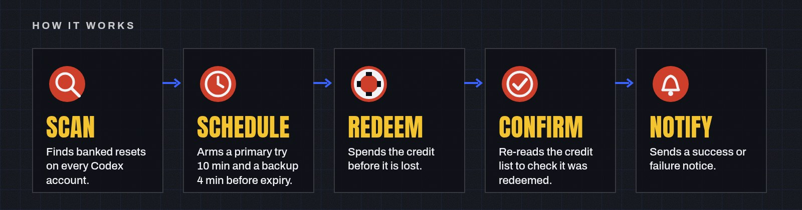
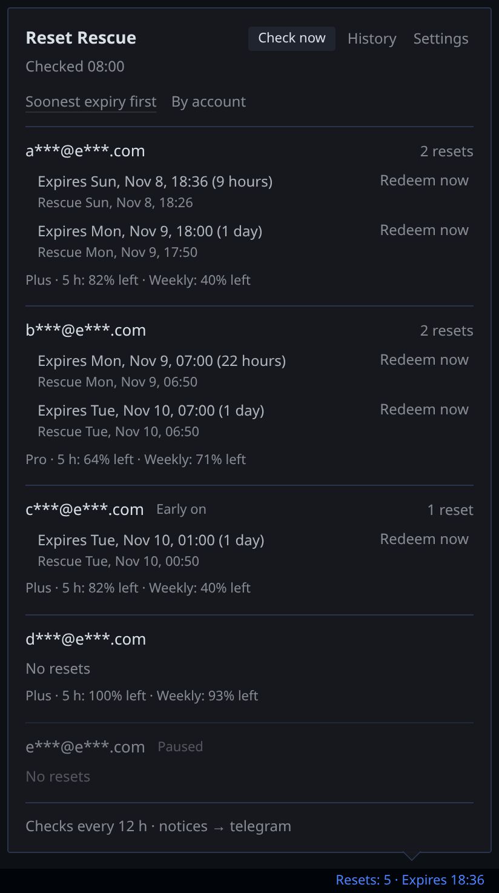
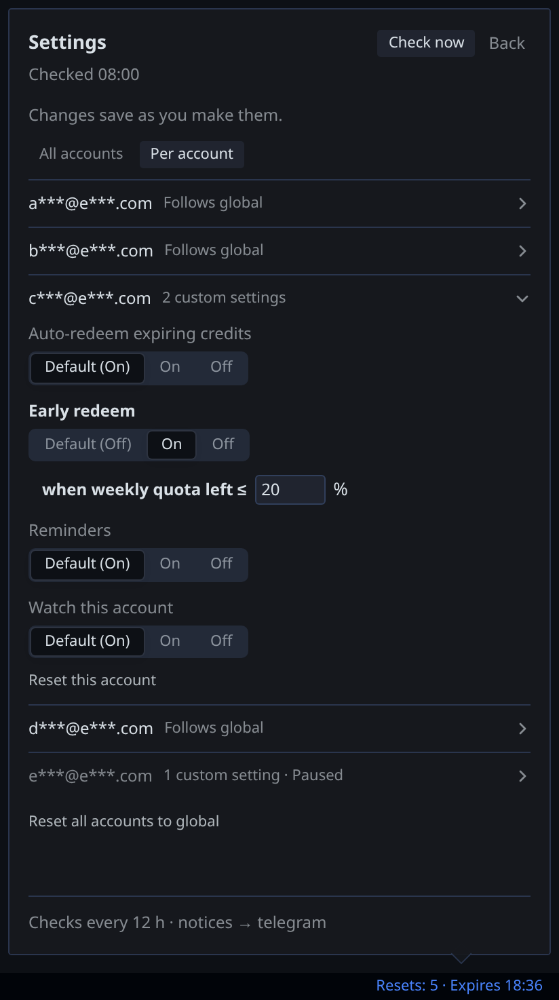
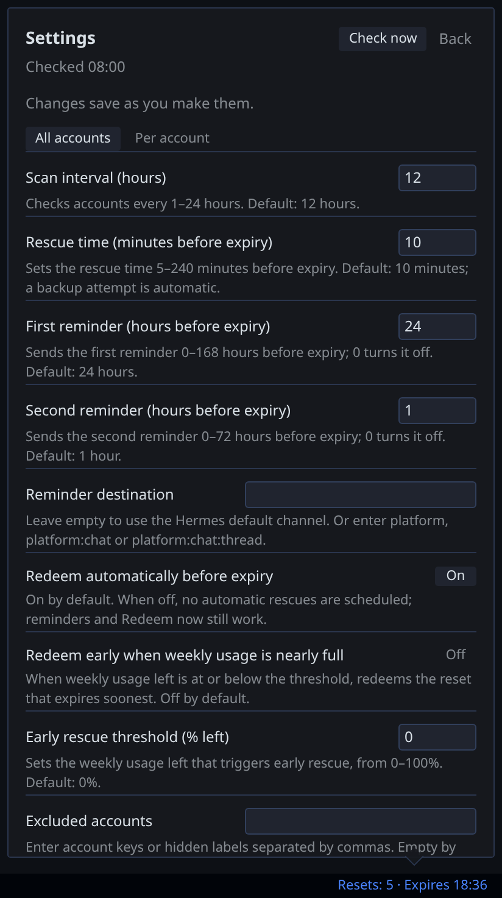

<p align="center">
  
</p>

# Reset Rescue

Reset Rescue is a Hermes Agent plugin that rescues expiring **OpenAI Codex rate-limit reset credits** across your profile's `openai-codex` credential pool. By default, it schedules a primary attempt 10 minutes before expiry and a backup 4 minutes before expiry, then checks the credit list to confirm the result. It uses Hermes cron, so the Desktop need not be open.

Free resets expired unused while their owner wasn't watching the clock. Reset Rescue was built to make those deadlines easier to keep—not to make an unconditional promise: a service outage can still prevent a rescue. **Never lose a Codex reset again** is the goal, not a guarantee.

<table>
<tr>
<td width="33%" valign="top">

<h3>Never lose a reset</h3>
<p>By default, each expiring credit gets a primary try 10 minutes before expiry and a backup 4 minutes before, through Hermes cron.</p>
</td>
<td width="33%" valign="top">

<h3>Every account, your rules</h3>
<p>Covers every <code>openai-codex</code> account in the pool. Set Watch, Auto, Early and Reminders per account; early redemption is opt-in.</p>
</td>
<td width="33%" valign="top">

<h3>Know when it happens</h3>
<p>Success and failure notices on a Hermes channel such as Telegram, plus a status-bar popup in Hermes Desktop.</p>
</td>
</tr>
</table>

<p align="center">
  
</p>

## Install

Requires **Hermes >=0.22.6**, Linux or macOS (Windows support is in progress), and at least one `openai-codex` account in the active profile. Sign in through Desktop or `hermes auth add openai-codex` first.

```bash
hermes plugins install https://github.com/bwoliveira/hermes-reset-rescue.git
hermes plugins enable reset-rescue
hermes reset-rescue ensure
```

In Hermes Desktop, enable the plugin's Desktop half in Plugins to show the status-bar chip. `ensure` installs or repairs the plugin's own launchers and cron jobs. A running Hermes scheduler is needed for unattended jobs. Automatic redemption is **on by default**; set `dry_run` before a rehearsal if you do not want to spend a credit.

## Use

Click the Desktop status-bar chip to open the popup. It lists every pool account, including those with no banked resets, with expiries, rescue times and a compact quota line (plan, 5 h and weekly remaining where available). Five full accounts fit; additional content scrolls. Sort by soonest expiry or account. Times use the Desktop's time zone; notices use Hermes' configured time zone or the host's.

- **Scan now** checks for changes. History shows the local activity log.
- **Redeem now** spends the selected credit only after confirmation; redemption is final.
- Two reminders default to 24 h and 1 h before expiry; each can be disabled. Success and failure notices use an existing Hermes channel such as Telegram: no new bot is needed.
- **Settings** saves changes as you make them. Language is English or pt-BR; `auto` follows Hermes, with English as the fallback.

The CLI also works without Desktop:

```bash
hermes reset-rescue status
hermes reset-rescue scan
hermes reset-rescue scan --dry-run
hermes reset-rescue ensure
hermes reset-rescue history
hermes reset-rescue redeem-now <credit> --yes
```

`--yes` confirms the CLI redemption. A dry run scans and schedules without consuming a credit.

## Settings

Change settings in the popup's **Settings** tab. Toggles and selections save on change; text and numbers save after a short pause or when the field loses focus. Inline feedback reports whether saving succeeded.

| Key | Type | Default | Bounds | What it does |
|---|---|---|---|---|
| `scan_interval_hours` | int | `12` | 1–24 | Scan interval in hours. |
| `lead_minutes` | int | `10` | 5–240 | Minutes before expiry for the primary attempt. The backup follows automatically (6 at the default), at 4 minutes before expiry. |
| `reminder_1_hours` | int | `24` | 0–168 | First reminder; `0` turns it off. |
| `reminder_2_hours` | int | `1` | 0–72 | Second reminder; `0` turns it off. |
| `notify_target` | str | `""` | Hermes delivery target | Notice destination; empty uses Hermes' configured channel. |
| `auto_redeem_enabled` | bool | `true` | — | Automatic expiry redemption; off leaves reminders and confirmed manual redemption available. |
| `early_redeem_enabled` | bool | `false` | — | Optional early redemption of the soonest-expiring credit when weekly quota remaining reaches the threshold. Off by default. |
| `early_redeem_remaining_pct` | int | `0` | 0–100 | Weekly quota remaining threshold; `0` means exhausted. |
| `excluded_accounts` | list | `[]` | — | Account keys or labels to skip; the popup accepts comma-separated text. Legacy CSV settings remain readable. |
| `mask_labels` | bool | `true` | — | Mask account names and email domains in the popup and notices. |
| `language` | str | `auto` | `auto`, `en`, `pt-BR` | Language of the popup and notices. |
| `dry_run` | bool | `false` | — | Keep scans, jobs and notices active without redeeming. |

### Per-account settings

With two or more pool accounts, choose **All accounts** or **Per account** in Settings. For each account, Watch, Auto, Early and Reminders can inherit the global value or be set on or off; expand the row to customize its early-redemption threshold. Reset returns an account to global settings. A paused account is not scanned, scheduled or notified, and cannot be manually redeemed until monitoring is restored. Disabling Auto still allows reminders and confirmed manual redemption on a monitored account.

With one account and no overrides, the per-account switch is hidden. If an override remains after other accounts are removed, it stays effective and a notice offers **Use global settings** to clear it. Reminder hours, lead time, destination and language remain global.

Early redemption is opt-in and off by default. While an opted-in account has banked resets, its weekly remaining percentage is checked every 15 minutes. At or below its threshold, the soonest-expiring credit is spent; another cannot be spent early until a fresh reading shows the quota above the threshold (D-009a).

## Safety and privacy

- The plugin never buys credits or enables overage. Automatic redemption is for credits due near expiry, except **opt-in** early redemption at your chosen weekly-quota threshold. A confirmed manual redemption can spend a credit earlier. The early feature is off by default.
- The list is read back after consumption; a request alone is not proof of success. Network outages or backend changes can prevent a rescue.
- Masking is on by default: `bob@example.com` appears as `b***@e***.com`; `example@example.com -> e***@e***.com`. You may unmask labels in the popup and notices; files and the activity log keep masked labels. Tokens and raw credit IDs are never logged. No telemetry or analytics.
- The local state contains salted account/credit keys, expiry times, masked labels, results, request IDs and the notice outbox; it does not store credentials. Reset credits are account-specific and are not shared or pooled across users.

## What this plugin does on your machine

Reset Rescue reads pool accounts through Hermes' `read_credential_pool` helper to act on each account. It uses each account's access token in memory for requests to `chatgpt.com`; tokens never reach the Desktop. It does not directly read or write `auth.json`, other profiles, or another tool's credential files. On a 401 it asks Hermes to refresh via `hermes auth refresh openai-codex`; Hermes performs the refresh. With an empty pool it falls back to `credentialed_provider_request` for the signed-in account.

The network calls are `GET /backend-api/wham/rate-limit-reset-credits`, `POST /backend-api/wham/rate-limit-reset-credits/consume`, and `GET /backend-api/wham/usage`. Consuming an owned credit is the only mutation to the service. Usage is checked for notices and optional early redemption. Redirects are refused. These endpoints are not a documented public API and can change.

The plugin creates its own Hermes cron jobs and launcher scripts in `<HERMES_HOME>/scripts/`, uses `hermes send` for notices, and stores local state under `<HERMES_HOME>/plugin-data/reset-rescue/`. The scheduler, rather than a plugin-owned long-running process, runs the jobs. **Catalog note:** pool token use is a disclosed deviation from catalog rule 11, not full compliance. Per-account redemption needs each entry's token, and `credentialed_provider_request` takes only a provider id and uses the active sign-in. The quota, hermes-resetwatch, account-pool and hermes-monitor entries use a similar pool read as precedent; that is not approval of this plugin's write path. The maintainer will move to a per-entry Hermes route once one exists.

## FAQ

**Will it redeem early?** Not automatically unless you enable early redemption. Its default threshold is 0% weekly quota remaining; a higher threshold is your choice. Confirmed **Redeem now** is a separate manual action.

**Does the computer need to be running?** The Hermes scheduler must be running and able to reach the service; closing Desktop alone does not stop its cron jobs. A sleeping or powered-off machine cannot run the jobs.

**Why is nothing scheduled?** Check `hermes reset-rescue status` and `hermes reset-rescue history`, the scheduler, sign-in, account monitoring and `dry_run`. A network failure or missing sign-in may require attention.

**How do I remove it?** Remove owned jobs and launchers before removing the plugin:

```bash
hermes reset-rescue uninstall
hermes plugins remove reset-rescue
```

Use `hermes reset-rescue uninstall --keep-data` to retain local state for a reinstall.

## Screenshots

Demo data and masked labels only, dark theme. Accounts, Per account with one account open, and Settings:

<p align="center">
  
  
</p>
<p align="center">
  
</p>

## Limits

Linux and macOS today; Windows support is in progress. The plugin operates on the active profile. A confirmed redemption cannot be undone.

### Known limits

Automatic rescue uses two Hermes one-shot jobs: primary 10 minutes before expiry and backup 4 minutes before, by default. Hermes tolerates about 2 minutes of lateness per job. If the gateway or scheduler is down across both windows, the credit expires unredeemed and the plugin reports it as missed on the next scan. Keep the gateway running; a larger `lead_minutes` widens the gap. Backend unavailability can also prevent a rescue.

## Terms

The service endpoints are not a documented public API. Use is subject to your OpenAI terms. Reset Rescue does not share or rotate accounts.

## Development

Run checks with `RUNTIME_WRAPPER=/path/to/run_runtime_script.py bash scripts/check.sh` using the audited Hermes runtime wrapper.
A missing wrapper or unavailable `hermes_cli` stops before the suites with one instruction and exit 2; `--list` and `--help` need no runtime.
`bash scripts/test.sh [suite ...]` runs tests; `check.sh` covers unit, desktop, render, lint (`ruff`), format, types (`mypy`), integration, end-to-end (e2e) and tree checks.
With the same `RUNTIME_WRAPPER`, run `bash scripts/release_gate.sh --release` before publishing.

Opt-in real cron validation: `RUNTIME_WRAPPER=/path/to/run_runtime_script.py bash scripts/ticker_check.sh` (outside the release gate).
It runs the real Hermes scheduler in a throwaway home (Linux, needs `unshare` and read-only bind mounts, about 4 minutes). Optional variables: `RR_LIVE_HERMES_HOME`, the profile kept read-only (default `$HOME/.hermes`), and `RR_HERMES_INSTALL`, the Hermes install directory (default `/usr/local/lib/hermes-agent`).
Requires Linux, `unshare`/mount privileges and the installed Hermes runtime; prepare native dependency state once with `bash scripts/ticker_prepare.sh` ([details](tests/live_ticker/README.md)). The isolated temporary Hermes home and loopback fake backend validation takes about 3–4 minutes.
The real home/install are read-only, networking is loopback-only, and logs + scenario table go to `/var/tmp/rr-rt/`. The real-scheduler check passed 8/8: native scan armed primary and backup; primary consumed once, read back, queued a notice and cleaned credit jobs; after three primary failures, backup succeeded with the same `redeem_request_id`; early redemption fired once at the global and per-account thresholds and not again on an unchanged reading; disable stopped dispatch; uninstall removed only plugin jobs. Notices were queued, not delivered, because the temporary home had no messaging platform.

## Prior art

Related projects include `quota`, `hermes-resetwatch`, `account-pool`, `hermes-codex-resets`, AURES, Codex Radar Sentinel and pi-better-openai. Reset Rescue combines pool-wide scheduling, confirmation by readback and Hermes notices.

## License

[MIT](LICENSE).
