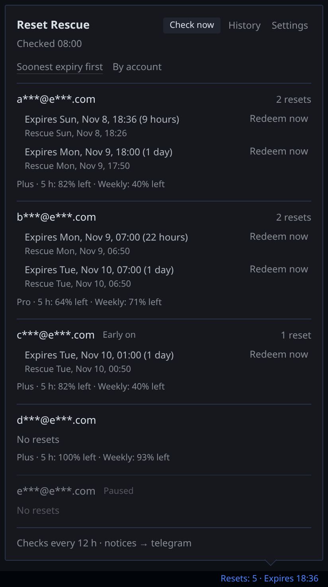
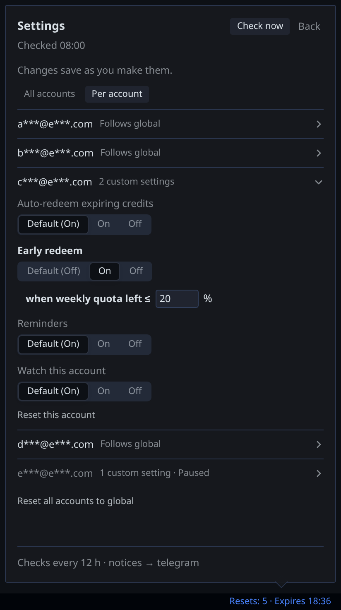
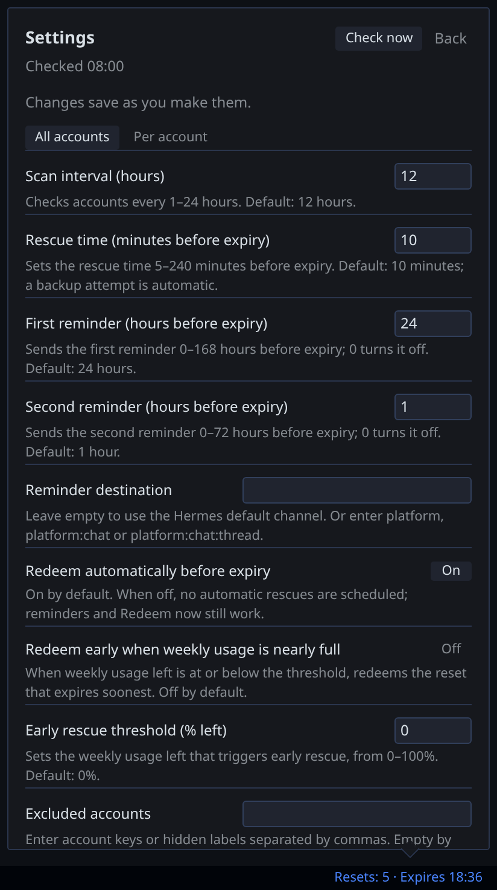

# Add Reset Rescue to the plugin catalog

> Draft for the public pin. Replace `<SHA>` with the reviewed public commit. Items under "Not yet run at the pinned commit" have not been verified and must pass before this PR is opened. This draft does not claim catalog admission or compliance.

## What it does

Reset Rescue redeems expiring OpenAI Codex rate-limit reset credits for the `openai-codex` accounts in the active Hermes profile. By default, Hermes cron schedules a primary attempt 10 minutes before expiry and a backup 4 minutes before. After each consume request, the plugin reads the credit list back and reports the result through the user's Hermes channel. Confirmed **Redeem now** can spend a credit manually. Optional quota-based early redemption is off by default. The plugin does not purchase credits or enable overage.

The Desktop status-bar popup lists every pool account, including accounts without banked resets. It shows history and settings that save on change, in English and pt-BR. Per-account overrides appear with two or more accounts.

- Repository: https://github.com/bwoliveira/hermes-reset-rescue
- Commit to review: `<SHA>` (replace at publication; do not link a branch)
- Maintainer: `bwoliveira`; version `0.1.0`; category `automation`; tier `community`; platforms Linux and macOS
- Hermes floor: `requires_hermes: ">=0.22.6"` in both `plugin.yaml` and the entry. The floor is derived from source history. Runtime testing so far used Hermes 0.23.0. Installation on 0.22.6 has not been run.
- Registered tools, hooks, middleware and required environment variables: none declared.

## Rule 11: exception request

The plugin reads each `openai-codex` account's token through Hermes, and it sends per-account requests with those tokens. Rule 11 requires a token-free route. We are asking for a maintainer decision on this path, not presenting it as compliant.

**What the plugin does with credentials**

- Calls Hermes `read_credential_pool('openai-codex')` to list the profile's pool. If the profile has no pool, Hermes' helper reads the global-root pool, read-only.
- Holds each account's access token in memory, only while requests for that account run. It does not store or log tokens.
- Does not parse or write `auth.json`, other profiles, or another tool's credential files.
- Sends Codex CLI client headers: `Authorization: Bearer`, `User-Agent: codex-cli`, `ChatGPT-Account-ID` from the token claim, and the residency header when the token carries one.
- On HTTP 401, runs `hermes auth refresh openai-codex <entry id>`. Hermes performs the refresh, and may rotate and save credentials in the pool.
- When the pool is empty, uses Hermes' `credentialed_provider_request` with `requires_auth: [openai-codex]`.

**Why an exception is needed now**

Per-account redemption needs each pool entry's token. `credentialed_provider_request` (`hermes_cli/plugin_provider_requests.py:134`) takes only a provider id and always uses the active sign-in, so it cannot target a pool entry. The gap is tracked upstream at https://github.com/NousResearch/hermes-agent/issues/137237. The plugin uses the active-sign-in route only as a fallback.

**What limits the risk**

- Reads go through Hermes' own pool helper, and writes to credentials go through Hermes' own refresh command.
- Each consume request is authorized by one function (`authorize_consume`) that checks the role, the automatic-redemption switch and the account's settings before any POST.
- Each credit gets one `redeem_request_id`, reused by the backup attempt. This prevents a retry from being sent as a new redemption. It does not guarantee exactly-once spending across every network failure. The plugin reads the credit list back after a consume to confirm.
- Automatic redemption can be turned off globally (`auto_redeem_enabled`) or per account.

**Precedent, with limits**

The four admitted entries below are cited as precedent for a pool read. This review did not check whether their write paths match this plugin's consume POST. Sources: [quota](https://github.com/rarf/hermes-quota-plugin/tree/89a2ca39a28dddcdcf01cf587519ea3861274b7a), [hermes-resetwatch](https://github.com/Adolanium/hermes-resetwatch/tree/7d1d6ca9f06a2331a9b155e794f61594be889aa5), [account-pool](https://github.com/roqianjas/hermes-account-pool/tree/7a4fc9fd976ed68de9e6f70ba326ef2053741e69) and [hermes-monitor](https://github.com/mr-3mm3/hermes-monitor/tree/ec6a3ada338ca3e06fbfc246bc672c3c776b0988). They are context, not approval.

**Commitment**

The plugin will move to a broker API that targets a pool entry as soon as Hermes provides one. The maintainer will open or follow the upstream request.

## Rule 13: disclosure

**Network**

- `GET https://chatgpt.com/backend-api/wham/rate-limit-reset-credits`: credit list, during scans and before redemption.
- `POST https://chatgpt.com/backend-api/wham/rate-limit-reset-credits/consume`: spends one owned credit on a due automatic attempt, an opted-in early redemption, or a confirmed manual action. This private endpoint is not a documented API and may change.
- `GET https://chatgpt.com/backend-api/wham/usage`: quota for notices and early-redemption checks.
- Redirects are refused. There is no telemetry or analytics.

**Writes**

- The plugin writes its own state under `<HERMES_HOME>/plugin-data/reset-rescue/`: salted account and credit keys, masked labels, expiry times, results, request IDs and the notice outbox. It stores no credentials.
- It creates and removes its own Hermes cron jobs and launcher scripts in `<HERMES_HOME>/scripts/`.
- It runs `hermes send` for notices and `hermes cron` for jobs.
- Hermes' `hermes auth refresh` may rotate and save credentials in the pool. The plugin does not write `auth.json` itself.

**Background work**

Hermes' scheduler runs the cron jobs, including while Desktop is closed. Reminders and redemptions need the gateway or scheduler running. If both automatic windows are missed, the credit expires, and the next scan reports it as missed. `hermes reset-rescue uninstall` removes the plugin's jobs and launchers before plugin removal.

**User controls**

- Global switches: `auto_redeem_enabled`, `early_redeem_enabled`, `dry_run`, `mask_labels`, `excluded_accounts`.
- Per-account overrides (two or more accounts): automatic redemption, early redemption, reminders, watch on or off.
- Confirmed Redeem now for a manual spend.
- Labels and domains are masked by default in the popup and notices. Tokens and raw credit IDs are never logged.

## Screenshots

Demo data and masked labels only. The screenshots show the English dark theme.

Screenshots show the layout only. They do not prove runtime behavior.

## Known limits

- Automatic redemption uses two Hermes one-shot jobs: primary 10 minutes before expiry and backup 4 minutes before, by default. Hermes tolerates about 2 minutes of lateness per job. A larger `lead_minutes` widens the gap between the two.
- Redemption depends on the gateway and scheduler running.
- The consume endpoint is private and undocumented.
- Idempotency is the design described above, with the limits stated there.

## Validation

**Verified on the candidate tree (2026-11-08, built from integration `18e76b5` with the pre-publication fixes)**

- `scripts/scan_repo.py --strict`: 33 findings, 0 unexplained, `RESULT: SAFE`. This is the repository scanner, not the install-time validator.
- Unit, integration and API test suites: see the results in the PR description.
- `scripts/ticker_check.sh` (opt-in, Linux, isolated temporary home, loopback fake backend): passed 8/8 in an earlier run. Scan armed primary and backup; primary consumed once and read back; after three primary failures, backup succeeded with the same `redeem_request_id`; early redemption fired once at the global and per-account thresholds; disable stopped dispatch; uninstall removed only plugin jobs. Notices were queued, not delivered, because the temporary home had no messaging platform.

**Not yet run at the pinned commit**

- `python3 scripts/validate_plugin_catalog.py plugin-catalog/` from a Hermes checkout.
- `hermes plugins validate <checkout> --install-deps` and `hermes plugins doctor <checkout>`, recording warnings and exact output, the Hermes version, and the candidate SHA.
- Installation and doctor on Hermes v0.22.6 (the floor). Not run.
- Linux and macOS runs of the popup and scheduler.

## Submission checklist

- [ ] Rule-11 exception decided by maintainers, or the credential path redesigned.
- [ ] Repository public; reviewed full 40-character commit pinned in the single `plugin-catalog/reset-rescue.yaml` entry.
- [ ] `requires_hermes`, `version` and declared capabilities checked against `plugin.yaml` at the pin.
- [ ] Validator, plugin validate and doctor run at the pin, with output recorded.
- [ ] Installation and doctor on v0.22.6 run, or the floor raised to the oldest tag where they pass.
- [ ] Screenshots attached from the pin, with masked labels only.
- [ ] One catalog YAML file submitted; wait for catalog CI and maintainer review.
